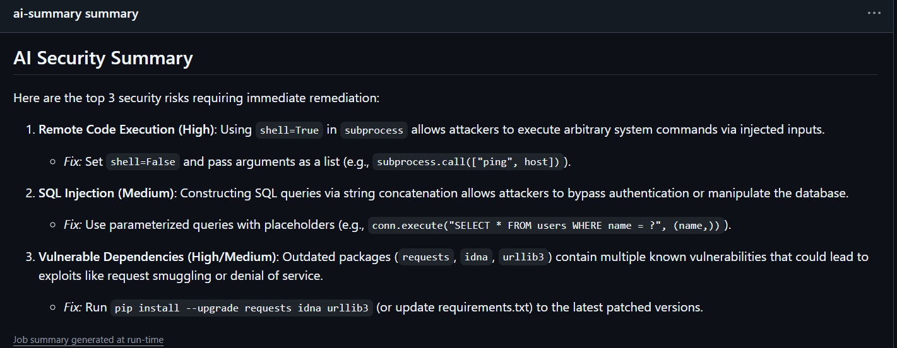

# DevSecOps Pipeline with AI Summary

A GitHub Actions pipeline that scans a small Python app for security problems on every push, then sends the results to Google Gemini to get a short summary of the top risks and how to fix them.

## How it works

Every push to the repo starts four jobs:

- **Bandit** scans the Python code for risky patterns
- **Semgrep** scans with OWASP Top 10 rules
- **pip-audit** checks the libraries for known vulnerabilities
- **A summary script** sends the Bandit and pip-audit output to Gemini and prints the top 3 risks with fixes

The Gemini API key is stored as a GitHub Secret, not in the code.

## What it found

The demo app (`app.py`) and the old `requests` version are vulnerable on purpose, so the scanners have something to find.

| Tool | Findings |
|---|---|
| Bandit | 4 issues in app.py (1 High, 1 Medium, 2 Low) |
| Semgrep | 4 findings (1 command injection, 3 unpinned GitHub Actions) |
| pip-audit | 13 unique vulnerabilities in 3 packages (requests, idna, urllib3) |

The first runs show red on purpose, because the scanners blocked the vulnerable demo app. After I fixed the code and the library version, the pipeline passes.

Example of the AI summary from one run:

## Notes

- Different tools caught different things. Bandit found the SQL injection and the hardcoded password, Semgrep found the unpinned actions, and pip-audit found vulnerabilities in packages that came in with `requests` (idna and urllib3).
- The AI summary only lists the top 3 risks, so it left out the hardcoded password that Bandit reported. Treat it as a draft, not the full report.
- The Gemini script needed two fixes along the way: a retired model name (404 error) and an overloaded API (503 errors). It now uses a lighter model and retries up to 5 times.
- I fixed the findings: parameterized SQL query, no shell=True (and an IP check on the input), the password read from an environment variable, and requests upgraded. Bandit now fails only on Medium and High findings.

## Next steps

- Pin the GitHub Actions to commit SHAs

**Tools:** GitHub Actions, Python, Bandit, Semgrep, pip-audit, Gemini API
